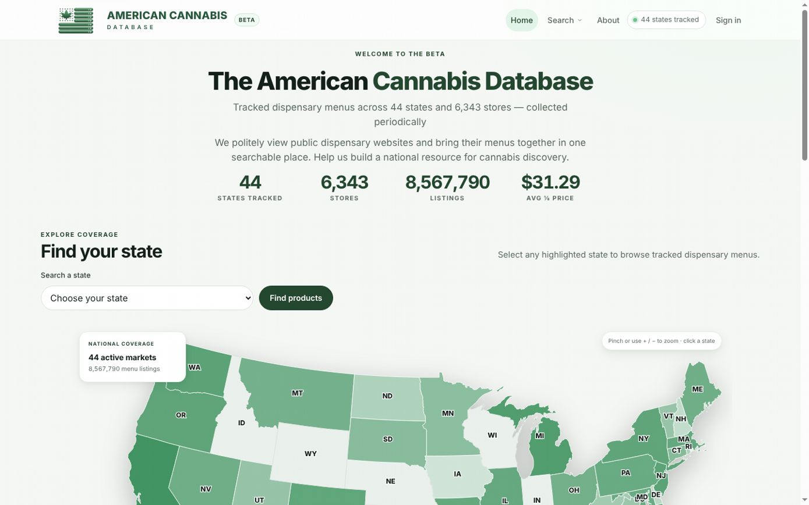
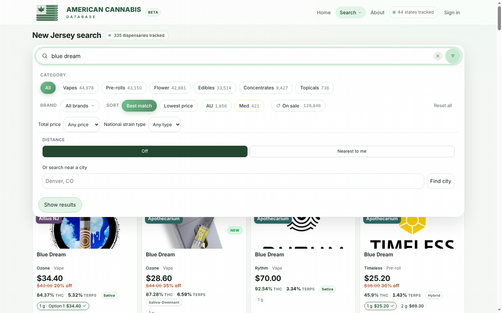
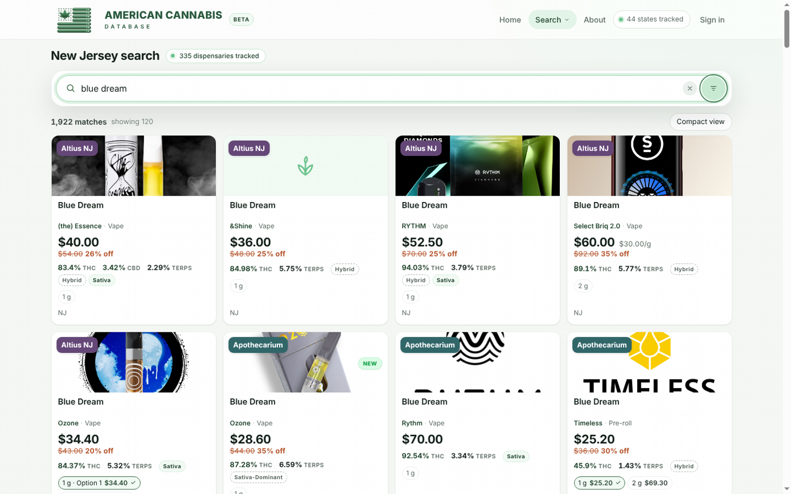
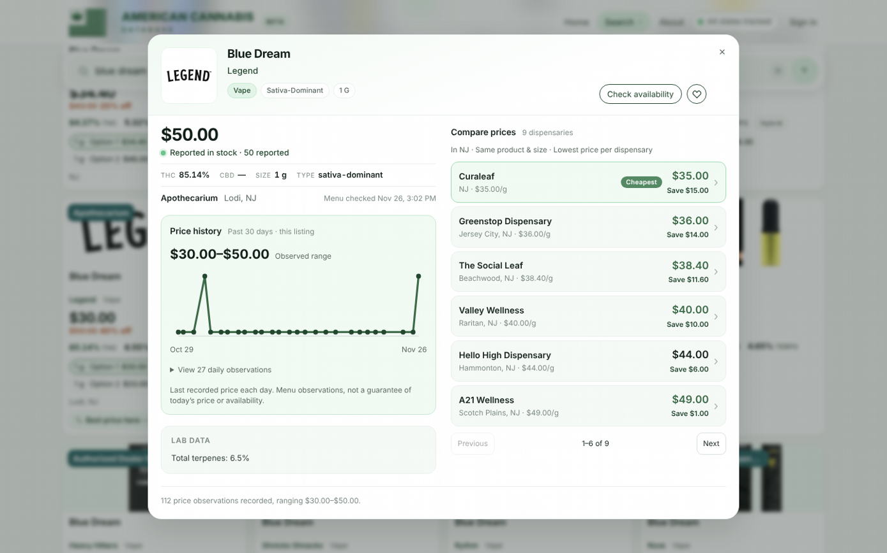
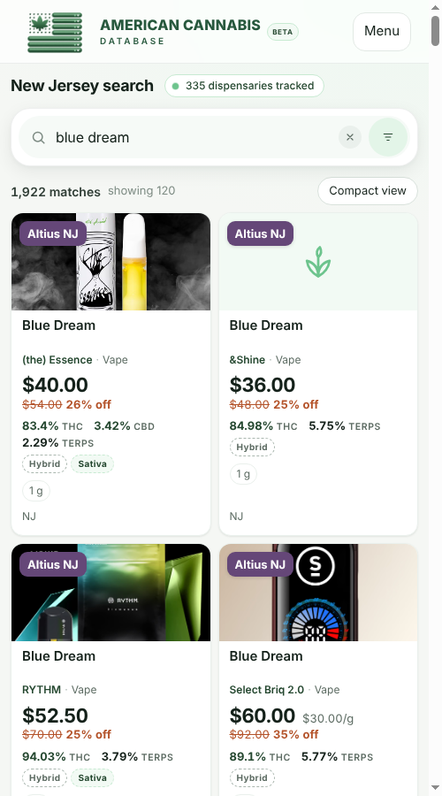

# American Cannabis Database

Search cannabis products, prices and stock across about 6,300 dispensaries in the US, in one place.

**Live site:** [americancannabisdatabase.com](https://www.americancannabisdatabase.com) (open beta, free; national search needs a free account)

This repo is a showcase. The source code is closed, so you won't find the app or the data pipeline here. What you will find is what the site does, how it's built, and the problems I had to solve to run it on one small server.

## What it does

- Search products by name, brand, category, state or distance from you
- Compare the same product across stores, with the cheapest in-stock price first
- See price history and stock history for a product over time
- Browse dispensaries by state, with a map and each store's current menu
- Save favorite stores and products to an account (Google sign-in or email)

Menus come from public dispensary menus and get refreshed through the day. The site is informational only. It doesn't sell anything or take orders.

## Scale

| | |
|---|---|
| Dispensaries | ~6,300 |
| Product listings | ~8.5 million |
| Price snapshots | ~240 million |
| Search index rows | ~3.1 million |
| Matched products | ~930,000 |
| Server | 1 small ARM VM (4 cores, 24 GB RAM) |

## Architecture

```
Browser
   |
Cloudflare (DNS, TLS, caching)
   |
Next.js app (server-rendered pages + JSON API)
   |
Postgres 17
   |-- product database: stores, listings, price history, search index
   |-- accounts database: users, favorites (kept separate on purpose)

Background jobs
   |-- menu collection, normalization and product matching
   |-- price refresh, twice a day
   |-- search index rebuild, nightly
   |-- daily rollups for price and stock history (rolling out in beta)
   |-- encrypted nightly backups, pulled to a second machine
```

Everything runs on one small cloud VM. Pages read from precomputed tables, so a request never has to touch the 240 million row history table directly.

## Problems I solved

**Fast search on small hardware.** The first version of search joined five tables and ranked every match on every request. A common word across the whole country took several seconds. I replaced it with a precomputed search table: one row per product per store, with the cheapest in-stock size, its price and its sibling sizes already worked out. It gets rebuilt in the background and swapped in with a rename, so search never goes down during a rebuild. Text search runs on a trigram index, and the page count comes from a small counts table instead of a full count.

**Query tuning, one slow query at a time.** I read query plans against real data and fixed what they showed. One example: sorting a single state by lowest price used to read every row in the state and keep the cheapest 120. California took 26 seconds cold. A matching index lets Postgres walk prices in order and stop after one page.

**Matching the same product across stores.** Every store names and sizes products its own way. A nightly matcher links listings to one canonical product using normalized brand, name, category and size, with a confidence score. Strong matches link on their own, borderline ones go to a review queue, weak ones stay unlinked. Some quirks need special care, like edibles where one source reports milligrams of THC and another reports package weight.

**A kill switch for each data source.** Every record carries the source it came from. Flipping one database row hides everything from a source on the live site within about 15 seconds, with no deploy or restart. The collectors stop fetching from it and the nightly rebuilds leave it out.

**Price history without running out of disk.** Snapshots are append-only and add up fast. Daily rollups, rolling out during the beta, condense history so the charts stay quick. The site reads a small "latest price" table instead of scanning history.

**Accounts kept apart from product data.** Users live in their own database. The web app connects with a role allowed to touch only the tables it needs. Passwords are hashed with bcrypt, Google sign-in is supported, and account backups are encrypted before they leave the server.

**Safe releases.** Each release is built into its own folder and switched live with a symlink, so rolling back takes one command.

## Tech stack

- **Frontend and API:** Next.js (App Router), React, TypeScript (strict), CSS Modules
- **Database:** PostgreSQL 17, raw SQL through `pg` (no ORM), trigram and composite indexes
- **Data pipeline:** Python, SQLAlchemy
- **Auth:** Google sign-in, email and password with bcrypt, 21+ age gate
- **Hosting:** Oracle Cloud ARM VM, Docker, systemd
- **Edge:** Cloudflare
- **Testing:** pytest, Vitest, Testing Library

The web app has seven runtime dependencies. Maps and charts are hand-built SVG, not libraries.

## Screenshots

**Home page:** coverage map and nationwide numbers



**Search with filters:** category, brand, price, strain type and distance



**Search results:** cheapest in-stock size per product, with sale prices



**Product view:** 30-day price history and the same product compared across stores



**On a phone**



## Status

Open beta. Coming soon:

- **Bud:** AI-powered product search you can chat with
- Back-in-stock alerts
- Better search ranking

## Author

Built by Eric Eaton. [LinkedIn](https://www.linkedin.com/in/eric-eaton-a46b211ba/)

